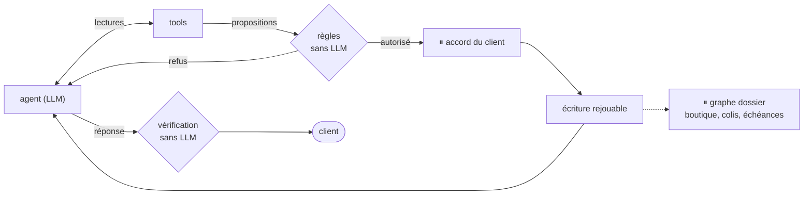

# Agent SAV

Un agent de service client pour une boutique de vêtements fictive, construit avec LangGraph. Il suit les commandes et traite
retours, échanges et remboursements. **Le modèle propose, des règles décident, le client confirme.**

## Comment ça marche



Le graphe complet : [pipeline_ecommerce.mmd](pipeline_ecommerce.mmd).

- **Deux graphes.** Le [chat](agent_sav/conversation.py) reste toujours disponible. Chaque demande a son
  [dossier](agent_sav/case_graph.py), avec son propre thread, qui peut attendre des jours : décision de la boutique, retour du
  colis, rappel, expiration.
- **Règles.** [policy.py](agent_sav/policy.py) accepte, soumet à la boutique ou refuse. Les montants viennent de là ; seul un
  geste commercial part du montant demandé, plafonné et toujours validé par la boutique.
- **Réponses vérifiées.** [grounding.py](agent_sav/grounding.py) retient une réponse qui cite un montant absent des outils, ou
  qui annonce une action que rien n'a enregistrée.
- **Pannes.** Checkpoints PostgreSQL, écritures à clé d'idempotence, commandes traitées une seule fois et dans l'ordre. Un arrêt
  entre deux écritures se reprend sans doublon.
- **Identité.** Aucun outil ne prend le client en paramètre : il vient du chat ouvert côté serveur.
- **Chronologie.** Le back-office montre chaque étape qui a mené au dossier, réponses retenues comprises.

## Explorateur de graphes

`/graphs` montre ce que LangGraph Studio ne montre pas : l'état partagé, ce que chaque nœud lit et produit (dans le schéma ou
non), par où on en sort et à quelle condition, et ce qu'il fait en base, requête par requête. Tout est
[extrait du code](agent_sav/graph_map.py) ; des tests comparent le résultat aux graphes compilés et à ce que les nœuds
exécutent vraiment.

## Évaluation

64 scénarios joués par un client simulé, notés sans LLM sur l'état final de la base. La référence est la version précédente,
un workflow où le LLM ne faisait qu'extraire des champs (tag `workflow-v1`).

| 56 scénarios communs, 1 essai chacun | Agent | Workflow |
|---|---|---|
| Réussite | 96 % | 55 % |
| Essais avec action non voulue | 0 | 4 |
| Essais avec escalade inattendue | 1 | 15 |
| Réponse P50 / P95 | 2,8 s / 7,7 s | 1,9 s / 6,2 s |

À lire avec prudence : un seul essai par scénario (un essai de l'agent, invalide, n'est pas compté), et l'agent a été corrigé
sur ces mêmes scénarios. Le workflow n'était prévu ni pour rembourser ni pour répondre aux questions.
[Rapport](evals/results/report.md).

```
python -m evals run --system agent --trials 5      # appels payants
python -m evals run --system workflow --trials 5
python -m evals report
```

## Lancer

Python 3.13 et Docker.

```
docker compose up -d --wait
pip install -r requirements-dev.txt
cp .env.example .env                  # renseigner MISTRAL_API_KEY
python -m agent_sav web               # http://127.0.0.1:8000
python -m pytest                      # aucun appel au modèle
```

La boutique est sur `/`, le back-office sur `/shop/support`, les mails des clients sur `/support/mailbox`, l'explorateur de
graphes sur `/graphs`. Ce mode partage une
seule boutique : il n'accepte que cette machine.

## MCP

Les outils du SAV sont aussi un serveur MCP, pour d'autres agents. Le jeton dit qui est le client, les mêmes règles
s'appliquent, et l'accord est demandé à la personne par élicitation : un client MCP sans élicitation peut lire, pas agir.

```
python -m agent_sav mcp-token --customer CLI-001
python -m agent_sav mcp               # http://127.0.0.1:8765/mcp
```

Dans l'autre sens, l'agent prévient l'opérateur par un
[serveur MCP de contact](https://github.com/tangmomb/mcp_contact_me) (`CONTACT_MCP_URL`, `CONTACT_MCP_TOKEN`) : un message
groupé, au plus toutes les 30 minutes, sans le texte des clients.

## Démo publique

`--public` donne à chaque visiteur sa propre boutique, dans sa propre base : il joue le client et la boutique sans voir les
autres. Limites par adresse, budget de tokens par jour, boutiques supprimées après 24 heures sans visite.

```
docker compose -f deploy/compose.yaml --env-file deploy/.env up -d --build
```

`deploy/.env` contient `SAV_DB_PASSWORD` et `MISTRAL_API_KEY` ; [deploy/Caddyfile](deploy/Caddyfile) publie le site.
